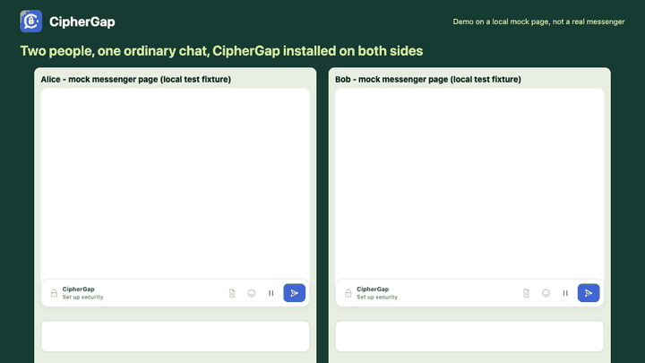
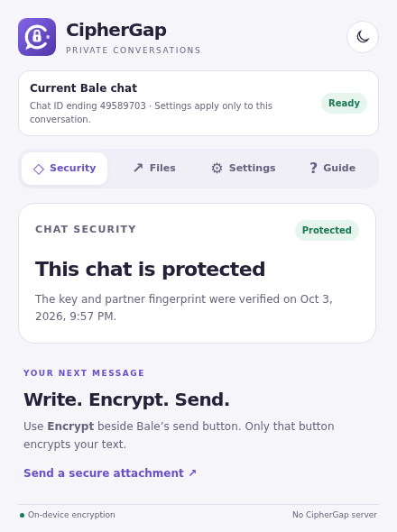
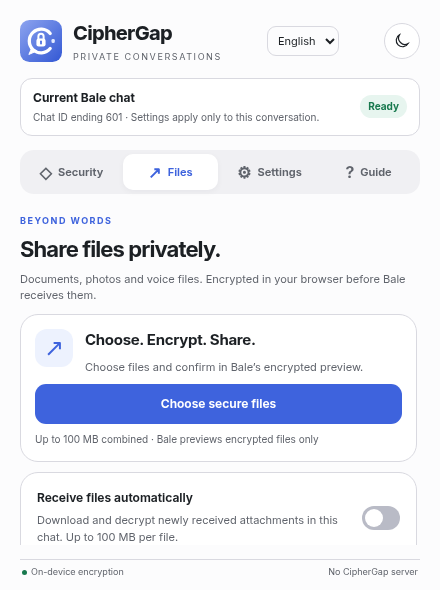
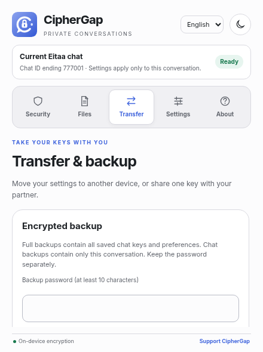
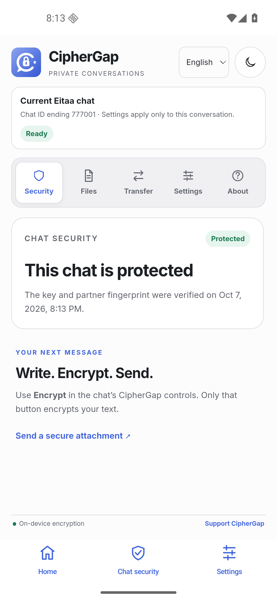

<div align="center">


# CipherGap

**Encrypt messages and files on your device before they reach the messenger. Keep chatting where you already chat.**

[](LICENSE)
[](https://github.com/alisharify7/CipherGap/releases/tag/v1.8.1)
[](https://github.com/alisharify7/CipherGap/releases/tag/android-v0.1.4)


[Website & installation guide](https://alisharify7.github.io/CipherGap/) · [Downloads](#downloads--desktop-170--android-014) · [Demo](#demo) · [Android source](https://github.com/alisharify7/CipherGap/tree/android) · [Changelog](CHANGELOG.md)

</div>

CipherGap is a **Chrome/Firefox extension** and an **Android app** that adds an Encrypt button to the web messenger you already use. Text, emoji, stickers and files are encrypted with AES-256-GCM locally, so the messenger only carries ciphertext. Your partner, who also runs CipherGap and holds the same chat key, reads it in the same conversation. CipherGap is free and open source (MIT), has no server, and works in Persian and English.

## Why CipherGap

* **Stay in your messenger:** keep using Bale, Eitaa, Telegram Web A, Rubika or Soroush Plus; there is no separate chat app to move to.
* **Keys stay with you:** per-chat keys are created on your device by ECDH key exchange with a six-digit code to compare. There is no CipherGap server or cloud processing.
* **Encrypts what matters:** messages, emoji, stickers and files (images, audio and video preview inside the chat after decryption).
* **Moves with you:** password-encrypted backups and offline key QR codes work between desktop and Android.
* **Open to review:** all source is public.

## Demo

A 34-second walkthrough of shipped behaviour: Alice sets up a secure chat, Bob accepts, they verify the code, Alice sends an encrypted message and Bob decrypts it. It was recorded against the **local mock messenger page** from the test suite (never a real messenger or account) by [`docs/demo/record_demo.py`](docs/demo/record_demo.py).

<p align="center"><a href="docs/demo/ciphergap-demo.webm"></a></p>

[Download the WebM video](docs/demo/ciphergap-demo.webm)

## Quick start

1. **Install** on both sides: the [Chrome/Edge/Brave or Firefox ZIP](#downloads--desktop-170--android-014), or the Android APK. Then open your messenger's web version.
2. **Set up a secure chat:** open a conversation, open CipherGap's **Security** page and choose **Set up secure chat**. Your partner accepts the request in the chat; compare the six-digit code over a trusted channel and mark the key verified.
3. **Send:** write your message and press the injected **Encrypt** button (or **Encrypted file** for attachments). Your partner clicks **Decrypt** or **Open**.

## Supported messengers

| Messenger | Web address | Notes |
| --- | --- | --- |
| Bale Web | web.bale.ai | |
| Eitaa Web | web.eitaa.com | Numeric IDs and usernames in the URL hash |
| Telegram Web A | web.telegram.org/a/ | Numeric chat IDs. Web K is not supported |
| Rubika Web | web.rubika.ir | Uses its `#c=<chat-id>` route |
| Soroush Plus Web | web.splus.ir | Numeric chat IDs |

WhatsApp is still in development.

## Features

**Security**
* AES-256-GCM message and attachment encryption, performed in the browser or app
* ECDH P-256 key exchange with a six-digit SAS verification step, in-chat accept/decline controls and a 15-minute exchange deadline
* Persistent peer-fingerprint change warnings (TOFU)
* Manifest V3 with no external servers or cloud processing

**Files and media**
* Encrypted Unicode emoji and static/animated stickers, shown inside the message
* Decrypt and preview images, play audio/video, or download the original file
* Optional automatic download/decryption of newly received files, per chat

**Transfer and backup**
* Password-encrypted full/chat backups (`.ciphergap`)
* Offline key QR generation and scanning
* Same shared format on Chrome, Firefox and Android 0.1.3+

**Usability**
* Separate Security, Files, Transfer, Settings and About pages with light/dark themes, Persian (RTL) and English
* Compact chat controls with icons and per-chat pause
* An installation guide for recipients without CipherGap, hidden while the extension is enabled

## See it in action

Screenshots of the app with sample data. Click an image to view it at full size.

<table>
  <tr>
    <th>Set up a chat key</th>
    <th>Send encrypted files</th>
    <th>Back up and transfer keys</th>
  </tr>
  <tr>
    <td><a href="docs/images/security.png"></a></td>
    <td><a href="docs/images/files.png"></a></td>
    <td><a href="docs/images/transfer.png"></a></td>
  </tr>
</table>

<details>
<summary>See the Android app</summary>

<a href="docs/images/android-security.png"></a>

The Android app uses the same shared keys and backup format as the desktop extension. Screenshots show desktop **1.7.0** and Android **0.1.3**; the Android download below is **0.1.4**. [Screenshot sources and capture details](https://github.com/alisharify7/CipherGap/blob/website/website/screenshots/provenance.json).

</details>

## New in 1.8.0

> Released in desktop **1.8.0**. The Android app (0.1.4) does not include them yet; its core is synchronized from this repository and a new Android build follows separately.

* **Forward secrecy (daily key ratchet):** new chat keys advance daily through a one-way ratchet. Keys older than a retention window (default 7 days, 1–90 in **Settings → Privacy & security**) are deleted, so a stolen key cannot open older messages. Those older messages become **unreadable by design**. Existing chats can opt in from the same page.
* **Stronger key derivation (message format v2):** HKDF-SHA256 for random keys and PBKDF2-SHA256 (600,000 iterations) for typed passphrases.
* **Authenticated headers:** AES-GCM additional data covers the message header (version, timestamp, purpose) and the file header (name, type, epoch), so tampering is detected. Messages are not bound to a chat ID, because each person's ID for the same conversation differs.
* **Self-destructing messages:** a timer button in the chat controls: 5 minutes, 1 hour, 24 hours, 7 days, or burn after reading (30 seconds after the recipient opens it). Enforced by CipherGap on each device; it cannot stop screenshots, copies or a modified client.
* **Secure group chats:** one member creates a group invitation from the popup; members join from the invitation card in the chat with one click, and the creator approves each person. Approval delivers the group key sealed (ECDH + AES-GCM) to that member only, so other members and the messenger cannot open it. Everything else (forward secrecy, self-destruct timers, files) works in the group. Fingerprints are shown on every card; approve only people you recognise. Removing someone means creating a new invitation and approving the remaining members again.
* **Optional app lock (browser extension):** a passphrase of at least 6 characters encrypts saved chat keys at rest. It locks after inactivity and when the browser closes, and slows repeated wrong guesses. A forgotten passphrase cannot be recovered; restore from an encrypted backup. Android does not have this lock yet.

**New in 1.8.1:** group creators can remove a member or rotate the group key; the popup shows each key's type, age and how far back messages are readable; an optional review step shows the ciphertext before sending; and an in-chat search finds decrypted messages loaded in the open chat.

**Refreshed interface:** the popup has a new calmer teal design with light and dark themes (Persian/English).

**Compatibility:** version 2 messages and files need **both people to update**; older versions cannot read them. Version 1 messages still open with keys that have not been ratcheted, but not after a chat's key has been ratcheted.

## Security model and limitations

* Encryption and decryption occur entirely on the client side; CipherGap has no backend.
* Incoming key exchanges require explicit approval and remain unverified until the SAS codes are compared. Manually shared keys stay unverified.
* Peer fingerprints are retained when a chat key is cleared so unexpected identity changes can still be detected.
* CGPE v1 authenticates the complete file before preview/playback and applies a 100 MB safety limit. Playback uses local decrypted bytes, not network streaming.
* Source code is publicly available for review and auditing.

Honest limitations:

* Both people need CipherGap and a shared key. Ordinary messenger buttons send ordinary, unencrypted messages and files.
* The messenger still sees that you are talking, with whom, when, and roughly how large messages and files are.
* Decrypted text and previews are displayed in the messenger page's DOM, so that page can read them. Keys and cryptographic operations stay in CipherGap's isolated script.
* In 1.7.0 and earlier, and in chats that keep a non-ratcheted key, a chat key is long-lived: anyone who obtains it can read every message encrypted with it. Forward secrecy (above) limits this for ratcheted keys.
* A compromised device, browser or extension environment defeats any client-side encryption.
* Telegram Web K is unsupported; WhatsApp is still in development. Firefox desktop builds are unsigned and installed temporarily.

> CipherGap improves privacy on supported messaging platforms, but no independent security audit is claimed. Review the cryptographic implementation yourself before relying on it for highly sensitive communications.

## FAQ

**Does my contact need CipherGap too?** Yes. They need CipherGap and the same chat key. Without it they see only ciphertext and an installation guide.

**Does CipherGap send my keys or messages anywhere?** No. There is no CipherGap server. Encrypted data travels only through the messenger you chose; backups are files you export yourself.

**What if I lose my backup password?** CipherGap cannot recover it.

**Can I use it on my phone?** Yes, with the Android app, which uses the same key and backup format as the extension.

**Do old messages stay readable after updates?** Yes so far: format upgrades keep old readers registered. The v2 format in 1.8.0 is the exception: it needs both people to update to read new messages.

[Support CipherGap](https://www.coffeete.ir/alisharify7) · [Changelog](CHANGELOG.md) · [Release notes for v1.8.1](docs/releases/v1.8.1.md)

## Installation

### Downloads — desktop 1.8.1 / Android 0.1.4

- [Chrome / Chromium / Edge / Brave ZIP](https://github.com/alisharify7/CipherGap/releases/download/v1.8.1/ciphergap-1.8.1-chrome.zip)
- [Firefox desktop ZIP](https://github.com/alisharify7/CipherGap/releases/download/v1.8.1/ciphergap-1.8.1-firefox.zip) — unsigned; temporary installation.
- [Android APK](https://github.com/alisharify7/CipherGap/releases/download/android-v0.1.4/ciphergap-android-0.1.4.apk) — signed release build; Android 8+ and a compatible WebView required.
- [Desktop SHA-256 checksums](https://github.com/alisharify7/CipherGap/releases/download/v1.8.1/SHA256SUMS) · [Android SHA-256 checksums](https://github.com/alisharify7/CipherGap/releases/download/android-v0.1.4/SHA256SUMS)

Follow the [installation guide](https://alisharify7.github.io/CipherGap/#installation).

### Manual Installation

```bash
git clone https://github.com/alisharify7/CipherGap.git
```

1. Open `chrome://extensions`
2. Enable **Developer Mode**
3. Click **Load unpacked**
4. Select the inner `CipherGap/` directory that contains `manifest.json`

The extension is now ready to use.

### Firefox (desktop)

Firefox desktop 140 or newer is required. Download the [`firefox` branch](https://github.com/alisharify7/CipherGap/tree/firefox), or build its package from main with `python3 tools/build_extension.py --target firefox`. The Chrome manifest on main uses a service worker; the generated Firefox manifest uses an event page.

1. Open `about:debugging#/runtime/this-firefox`.
2. Click **Load Temporary Add-on** and select `CipherGap/manifest.json`.
3. Open or refresh the supported messenger.

Temporary Firefox installs are removed when Firefox restarts. For a permanent
install, package and sign the extension through Firefox Add-ons (AMO).

## Usage

1. Open a conversation in [Bale Web](https://web.bale.ai/), [Eitaa Web](https://web.eitaa.com/), [Telegram Web A](https://web.telegram.org/a/), [Rubika Web](https://web.rubika.ir/) or [Soroush Plus Web](https://web.splus.ir/). Eitaa accepts numeric IDs (`#333000`) and usernames (`#@mralizohdi`) in the URL hash. Telegram and Soroush use numeric chat IDs; Rubika uses its opaque `#c=<chat-id>` route.
2. Open CipherGap's **Security** page and choose **Set up secure chat**.
3. The other participant clicks **Accept request** on the request in the chat. Replacing an existing key requires an additional confirmation.
4. Within 15 minutes of sending the request, compare the six-digit code over a trusted channel, then mark the key verified on both sides. Request expiry does not delete existing chat keys.
5. Use the injected **Encrypt** button to send an encrypted message. Use **Encrypted file** to send `.cgpe` attachments. The messenger’s ordinary attachment picker sends ordinary files.

A manually shared key is available under **Settings → Advanced**, but it remains marked unverified.

Encrypted messages end with a Persian installation guide and both GitHub and the installation website links.
CipherGap hides this guide in the conversation while enabled and shows it again
when paused. Both participants should use 1.4.0 for Eitaa or Telegram (1.3.0 or later
can read the guide on Bale); older encrypted messages remain readable with their original key.

Open **Files → Choose secure files**, or use **Encrypted file** in the chat’s CipherGap toolbar.
Select files and confirm the messenger’s preview, which contains encrypted `.cgpe` files.
The receiver clicks **Open** to open images or a native audio/video player inside the chat, with **Download** to save the original. Unsupported formats remain downloadable; HTML and SVG are never embedded. Enable
**Files → Receive files automatically** separately in each chat to download and
decrypt newly received attachments while that conversation is open. Previously
received files require a click; opening a chat does not download its history.
The original filename is retained. If direct download is unavailable, download
the `.cgpe` through the messenger and use **Choose downloaded file instead**.

## Transfer keys and settings

Open **Transfer** in the popup. Enter a separate backup password of at least
10 characters, then choose **Export everything** or **Export this chat**.
The `.ciphergap` file is encrypted locally with PBKDF2-SHA256 (250,000 iterations,
a random 16-byte salt) and AES-256-GCM. Keep the password separately; CipherGap
cannot recover it. No backup or key is sent to a server.

On your other device, enter the same password and choose **Import a backup**.
**Restore to original chats (my device)** restores saved keys, chat preferences,
partner trust/fingerprints, language, theme and the global enabled setting.
Existing unrelated conversations are retained. You must sign into the same
messenger accounts separately: backups contain no messenger sessions or history.
Pending exchanges, replay nonces and previously downloaded-file markers are
runtime state and are not transferred.

To give your partner one key, export a chat backup and select **Use key in
current chat (partner)** on their device. This maps only the key to their current
conversation; their chat ID can differ from yours and your trust record is not
copied. Every import previews the number of chats and replaced keys and requires
confirmation. Active key exchanges must finish or be declined first.

**Show key QR** shares the exact UTF-8 key as `ciphergap-key:1:<Base64>`.
Anyone who sees it can obtain the key. Show it privately. The recipient opens
the destination chat and uses **Scan with camera**, **Read QR image**, or
**Paste scanned key**, then reviews the import. Shared keys remain unverified.
QR generation and scanning work offline; camera access stops on close/hide.

The shared transfer format works in Chrome/Firefox and Android **0.1.3+**.
Older APKs do not include this screen. Download the Android release above;
messenger accounts and WebView compatibility remain
separate prerequisites. Future format readers must retain version 1 support.

## Emoji and stickers

Use **Emoji & stickers** (the smile icon) in CipherGap's chat toolbar.
**Emoji** inserts Unicode into your draft; press **Encrypt** to send it securely.
Native image-backed Unicode emoji, skin tones and joined emoji sequences are retained.

Under **Stickers**, choose a built-in emoji sticker or **Choose sticker file**.
PNG, JPEG, WebP, GIF, AVIF and animated WebM are supported, up to **5 MB**.
The messenger preview contains only a `.cgst.cgpe` encrypted file. Confirm Send there.
The receiver clicks **Open** to show the authenticated sticker inside its message.
Click an image for a larger view or use **Download** to save its original bytes.
Animated WebM uses native playback controls; no autoplay is required.

Both participants need **1.5.0** for inline stickers. The sticker purpose, original
name and media type are sealed inside the existing CGPE encrypted body. Saved
keys, legacy text and normal CGPE files remain compatible. Ordinary native
sticker menus send ordinary stickers; Telegram custom emoji packs and TGS/Lottie
are not intercepted. Use CipherGap's picker for encrypted stickers.

## Language and pause controls

Choose **فارسی / English** in the popup header. Language is shared with the chat controls and persists locally. The UI supports RTL/LTR and bundled Vazirmatn/Inter fonts.

Under **Settings**, turn **CipherGap enabled** off to pause all chats, or **Enabled in this chat** off to pause only the current conversation. The in-chat **Pause chat / Enable chat** button controls the same setting. Keys are retained; encryption, incoming decryption, automatic file downloads and new key exchanges stop while paused. Decrypted text and sticker previews are removed immediately; original ciphertext and installation links are restored.

[Website and installation guide](https://alisharify7.github.io/CipherGap/) · [Website branch](https://github.com/alisharify7/CipherGap/tree/website)

## Tech Stack

* JavaScript
* HTML/CSS
* WebExtensions API (Manifest V3 for Chrome and Firefox)
* AES Encryption

## Architecture

Messenger-independent code lives in `CipherGap/share/`. It is the single source
of truth for message and key-exchange formats, AES/ECDH utilities, the CGPE file
container, storage-key names, adapter registration, media viewer, sticker envelope/picker, shared chat presentation, exchange cards and theme tokens. The shared chat lifecycle, file handoff, message rendering and UI mounting live in `CipherGap/content/chat_runtime.js`. Small `bale.js`, `eitaa.js`, `telegram.js`, `rubika.js` and `splus.js` modules supply native selectors, input/send behavior and attachment controls.

Integrations use stable IDs, roles, message/document data attributes and structural attachment children. They do not select messenger CSS classes. Native layout identifies incoming/outgoing rows. Telegram’s native editor receives input events; its send control is resolved only after the draft appears.
The small MAIN-world bridge observes native Blob downloads, handles Eitaa’s bounded Service Worker download path, and transfers only
the requested encrypted container to the isolated content script. Keys and cryptographic operations stay in the isolated content script. Decrypted
text and previews are displayed in the messenger DOM and can be read by that page. Message drafts are
preserved during key exchange, and asynchronous sends are bound to their chat.

Future WhatsApp integrations should implement the messenger
adapter contract documented in `CipherGap/share/README.md`; they must not copy
encryption or packet-format code. Format upgrades add a new immutable codec and
keep old readers registered, so existing messages and files remain compatible.

Telegram, Rubika and Soroush expose no machine-readable sending timestamp. Automatic receiving ignores the initial one-second settling period and messages at or below the observed message-ID baseline; missed or historical files remain available through **Open**. Undated legacy exchange requests on Telegram require a new timed request. Eitaa’s app-encrypted cache (when an app passcode is enabled) falls back to native download handling. The manual downloaded-file option remains available on every platform.

## Contributing

Run the regression checks with `node --test tests/*.test.js`.
Both browser packages share every source file except the generated manifest.
The Android build packages those same source files; its launcher, allowed origins
and path restrictions come from the shared registry and manifest. Main changes
are automatically copied to the Android core, tested and built by
[the Android synchronization workflow](.github/workflows/sync-android.yml).
[Firefox builds and automatic branch synchronization](docs/firefox.md) includes
package and isolated browser checks.
See [the browser validation record](docs/browser-validation.md) for the tested
two-account Bale workflows and current limits.

Contributions, bug reports, and feature requests are welcome.

1. Fork the repository
2. Create a feature branch
3. Submit a pull request

## License

Released under the MIT License.

---

⭐ If you find CipherGap useful, consider starring the repository.

New messenger browser checks: `python3 tests/browser_messengers.py` (Playwright/Chromium) and `PYTHONPATH=/tmp/ciphergap-firefox-tools python3 tests/browser_messengers_firefox.py` (Marionette; install `marionette-driver` in your chosen environment). These use isolated profiles and sanitized DOM fixtures. Live account checks and limits are recorded in [browser validation](docs/browser-validation.md).
